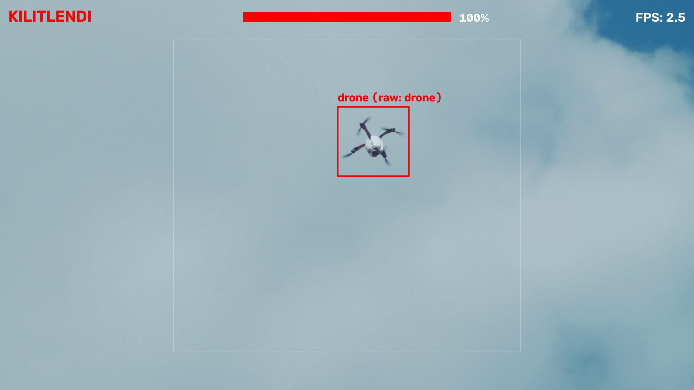
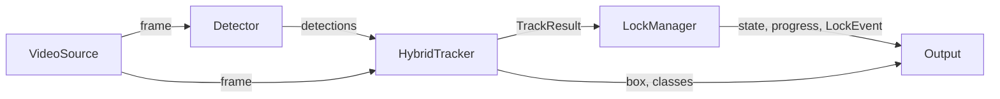
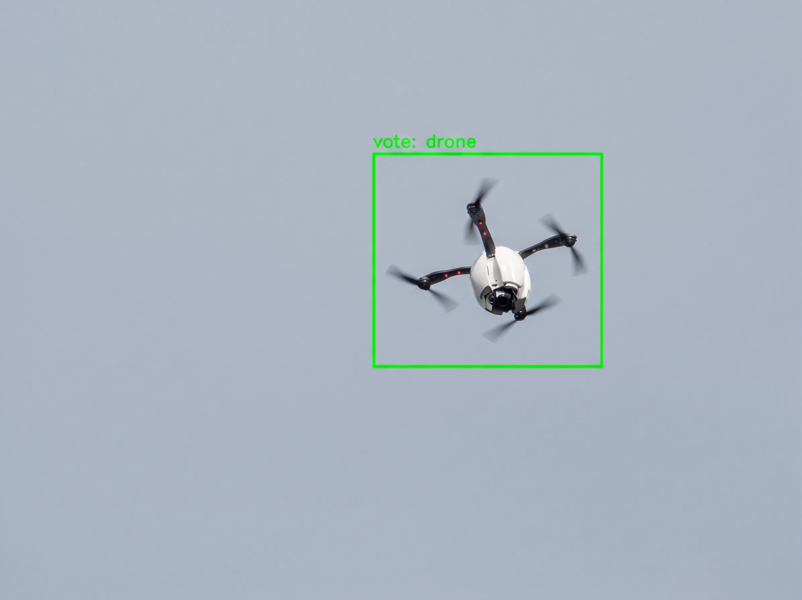
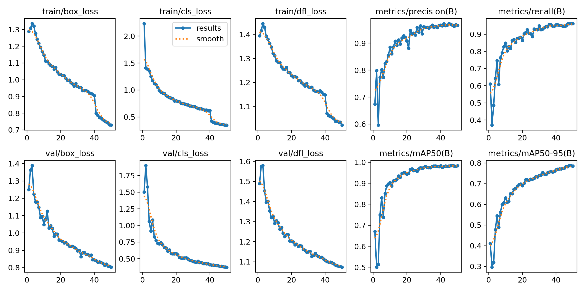
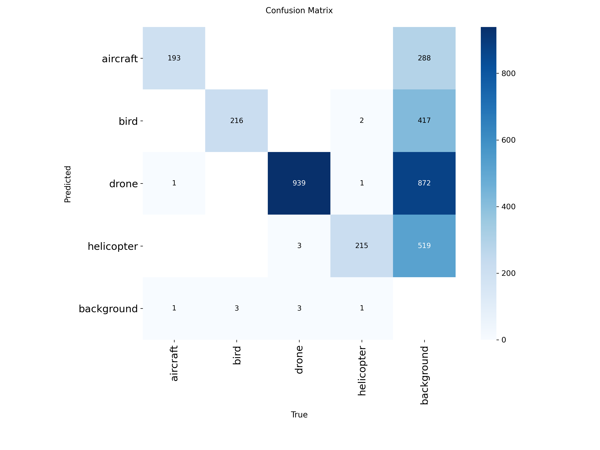

# uav-lock-on

A computer-vision pipeline that mimics the image-processing part of the Teknofest *Savaşan İHA* (fighter UAV) task: it detects an opponent UAV in video with a custom-trained YOLO11n model, follows it with a hybrid detector + KCF tracker, stabilises its class with temporal voting, and declares a **lock** once the target has stayed inside the lock region, large enough and of the right class, for a fixed time. The project is built as a set of small, independently testable modules driven by a single YAML config.



---

## Architecture



| Module | File | Responsibility |
|---|---|---|
| VideoSource | `src/source.py` | Reads frames from a video file or a webcam and exposes FPS and frame size. |
| Detector | `src/detector.py` | Runs YOLO on a frame and returns boxes filtered by confidence and class. |
| HybridTracker | `src/tracker.py` | Follows a single target by mixing periodic YOLO detections with a fast KCF tracker, and votes on its class. |
| LockManager | `src/lock_manager.py` | State machine that decides when the lock conditions have held long enough. |
| Output | `src/output.py` | Draws the HUD, shows/saves the video and writes lock events to JSON. |

`main.py` wires these together from `configs/config.yaml` and measures the time spent in each module.

**Why modular:** each module only depends on the small interface of the one before it. Swapping the source (file → webcam → camera stream), the model (YOLO11n → a larger or exported model) or the tracker (KCF → CSRT) changes one module and one config line; the rest of the pipeline is untouched. Every module also has its own `if __name__ == "__main__":` test, so it can be checked in isolation.

---

## Key design decisions

### 1. Hybrid tracking

Running YOLO on every frame is too slow on a CPU. Instead, YOLO runs **once every 5 frames** and a **KCF** correlation tracker fills the frames in between.

- YOLO is accurate but slow; it re-initialises the tracker each time, which **corrects the drift** that trackers accumulate.
- KCF is fast but drifts; it **fills the gap frames cheaply**.
- If the tracker loses the target, YOLO runs on the very next frame instead of waiting for its turn.

### 2. Track classes vs. lock classes

Two separate questions, two separate config keys:

- `detector.track_classes: [drone, aircraft, helicopter]`: *what do we follow?* Anything that flies, except birds.
- `lock.target_classes: [drone, aircraft]`: *what are we allowed to lock on to?*

Keeping them apart means the tracker keeps following a target even while its class is uncertain, and only the lock decision is restricted.

### 3. Temporal class voting

This is the part of the project that went through a full **measure → find the bug → fix → re-measure** loop. All numbers below come from the same test video (259 frames, 4K, 25 FPS; YOLO ran with a target on 49 frames).

**Observation.** On real video the model calls the same quadcopter *drone* on some frames, *aircraft* or *helicopter* on others.

**Diagnosis.** At a distance these classes collapse into similar small silhouettes, and the training images (a Roboflow dataset) look different from this footage (*domain gap*).

**Solution.** `HybridTracker` keeps the classes of the last `vote_window = 10` detections and reports the majority as `voted_class`. The lock decision uses `voted_class`, never the single-frame class.



*Single-frame prediction says "helicopter", but temporal voting keeps the target class stable as "drone".*

**Measured results:**

| Stage | Class changes (over 49 YOLO frames) | Class counts | Class in lock event |
|---|---|---|---|
| 1. Raw YOLO | 29 | drone 29 / aircraft 11 / helicopter 9 | n/a |
| 2. Voting v1 | 6 | drone 46 / aircraft 2 / helicopter 1 | `aircraft` |
| 3. Voting v2 (after fix) | 8 | drone 45 / aircraft 3 / helicopter 1 | `aircraft` |

- **Stage 1 → 2:** voting reduced class changes from 29 to 6.
- **Bug found in v1:** at frame 75 the KCF tracker failed for one frame, and the tracker's reset logic **wiped the whole vote history**. Voting restarted from an almost empty window, and at frame 101, the exact frame the lock was confirmed, the vote came out *aircraft 3 vs drone 2*. The lock event was logged as `aircraft`.
- **Fix (v2):** a one-frame tracker failure now only drops the tracker (so YOLO runs on the next frame) and **keeps the votes**. The history is cleared only when the target is really gone: after `tracker.reset_after_missed_frames = 15` consecutive frames with no target at all, or when the detector re-acquires a box whose centre is more than half the frame diagonal away from the last known box (most likely a different object).
- **Re-measurement:** the fix behaves as intended (the history now survives frame 75), but on this video it does **not** change the outcome. At frame 101 the last 10 raw predictions (frames 56–101) were *aircraft 5, drone 3, helicopter 2*, so the majority really is `aircraft`. The non-drone voted classes in v2 appear at the YOLO frames 101, 116, 131 (`aircraft`) and 216 (`helicopter`), each until the next YOLO frame.

**Remaining limit.** Voting can only smooth out errors when the model is right most of the time. In the stretch of this video where the model is wrong about half of the time, the vote follows it. The real fix is upstream: **fine-tuning on real video frames** to close the domain gap.

### 4. Lock state machine

`LockManager` has **4 states**:

```
ARANIYOR (searching) -> HEDEF VAR (target) -> KILITLENIYOR (locking) -> KILITLENDI (locked)
```

and **3 conditions** that must all hold on a frame:

1. **Class:** `voted_class` is in `lock.target_classes`.
2. **Region:** the whole box is inside the lock rectangle.
3. **Size:** box width or height is at least `min_box_ratio` of the frame.

- **Duration is counted in frames, not wall-clock seconds:** `required_frames = lock_duration_s × video FPS`. This makes the result independent of how fast the computer processes the video: a 4-second lock means 4 seconds of *video*, even if processing runs at 2 FPS.
- **Flicker tolerance:** if the conditions fail for up to `max_lost_frames` frames, the progress is kept (not counted, not reset). On the test video this tolerance absorbed a one-frame tracker loss at frame 75 and the 5-frame `helicopter` vote at frames 216–220.
- A `LockEvent` (start time, end time, class, box) is emitted exactly once per lock.

---

## Training

- **Dataset:** Roboflow Universe [Drone detection](https://universe.roboflow.com/computer-vision-yxj4a/drone-detection-oqauc) (workspace `computer-vision-yxj4a`, project `drone-detection-oqauc`, version 3): 7307 images, 4 classes (`aircraft`, `bird`, `drone`, `helicopter`), CC BY 4.0.
- **Model:** YOLO11n, COCO-pretrained.
- **Settings:** 50 epochs, `imgsz=640`, `batch=16`, `patience=10`; about 1.15 hours on a Colab T4.
- **Notebook:** [`notebooks/01_train_uav_detector.ipynb`](notebooks/01_train_uav_detector.ipynb)





## Results (validation)

**All classes:** Precision 0.963 · Recall 0.963 · mAP50 0.983 · mAP50-95 0.788

| Class | mAP50 | mAP50-95 |
|---|---|---|
| aircraft | 0.988 | 0.840 |
| bird | 0.973 | 0.825 |
| drone | 0.994 | 0.752 |
| helicopter | 0.975 | 0.733 |

- **Drone has the best mAP50 but a low mAP50-95.** The model finds drones very reliably, but its boxes are less precise. Drones are small, so a shift of a few pixels lowers the IoU a lot at the strict thresholds. This is one reason the lock logic has tolerance built in.
- **Caveat:** the validation set comes from the same source as the training set. Performance on real, unseen video is lower (see the class-voting section above).

## Real-video findings

- `conf_threshold = 0.4` missed frames on real video; it was lowered to **0.25**.
- `img_size = 960` was tried at inference and gave **worse** results. The model was trained at 640, and the scale mismatch hurts more than the extra resolution helps.

---

## Performance

### Tracker experiments (CPU laptop, no GPU)

| Setup | FPS |
|---|---|
| YOLO on every frame | ~4.5 |
| YOLO every 5 frames + CSRT | ~6 |
| YOLO every 5 frames + KCF | ~15 (~3.3× vs. every-frame YOLO) |

**GPU vs. CPU:** YOLO inference takes **3.1 ms per frame on a T4** vs. **~200 ms on the CPU** (more than 60× faster). This is why UAVs carry GPU boards such as the NVIDIA Jetson for onboard vision.

### End-to-end pipeline (`python main.py`)

Measured by `main.py` on the 4K test video (3840×2160, 259 frames), on the same CPU laptop, with the display window and MP4 saving enabled:

| Module | Calls | ms / call | ms / frame |
|---|---:|---:|---:|
| source.read | 259 | 51.20 | 51.20 |
| detector (YOLO) | 57 | 186.27 | 40.99 |
| tracker total (YOLO + KCF) | 259 | 210.34 | 210.34 |
| ↳ of which KCF + voting | 259 | 169.35 | 169.35 |
| lock_manager | 259 | 0.03 | 0.03 |
| output (draw + save/show) | 259 | 202.14 | 202.14 |
| **Average FPS** | | | **2.2** |

- The end-to-end number is much lower than the tracker experiments because it includes the full cost of 4K video: decoding, running KCF on 4K frames, drawing, displaying and encoding a 4K MP4.
- On this video, decoding, KCF and output each cost about as much as YOLO or more. Downscaling the frames before tracking would be the first optimisation.
- Timings vary noticeably between runs on the same laptop (full runs measured between 2.2 and 2.8 FPS), so treat these as orders of magnitude.
- `lock_manager` is effectively free (~0.03 ms).

---

## Configuration

Everything is set in [`configs/config.yaml`](configs/config.yaml); `main.py` contains no hard-coded parameters.

| Section | What it controls |
|---|---|
| `source` | Video file path, or `0` for a webcam. |
| `detector` | Model weights, inference image size (must match training), confidence threshold, and `track_classes`. |
| `tracker` | Tracker type (`kcf`/`csrt`), how often YOLO runs, the vote window, and `reset_after_missed_frames`. |
| `lock` | `target_classes`, the lock region (fractions of the frame), `min_box_ratio`, `lock_duration_s`, `max_lost_frames`. |
| `output` | Show window, save video, output video path, JSON log path. |

> **Note:** the lock region (`x 0.25–0.75`, `y 0.10–0.90`), `min_box_ratio = 0.05` and `lock_duration_s = 4.0` are **assumptions**. They have **not** been verified against the current Teknofest Savaşan İHA specification and should be checked before any real use.

---

## How to run

```bash
conda create -n uavlock python=3.11
conda activate uavlock
pip install -r requirements.txt

# ultralytics pulls in opencv-python, which lacks the KCF/CSRT trackers.
# Replace it with the contrib build that includes them:
pip uninstall -y opencv-python
pip install --force-reinstall --no-deps opencv-contrib-python
```

Model weights and videos are not part of the repository. Put the trained model at `weights/best.pt` and the test video at `videos/test.mp4`.

```bash
python main.py                 # uses configs/config.yaml
python main.py --source 0      # webcam
python main.py --config configs/other.yaml --source videos/other.mp4
```

While running: `q` quits, `p` pauses/resumes. Results go to `outputs/result.mp4` and `logs/lock_events.json`, and a per-module timing table is printed at the end.

Each module can also be run on its own:

```bash
python src\source.py videos\test.mp4
python src\detector.py
python src\tracker.py
python src\lock_manager.py     # logic test, no video needed
python src\output.py           # synthetic scene; add --headless to skip the window
```

---

## Limitations & future work

- **Fine-tune on real footage.** The class flips in the voting section come from the domain gap between the dataset and real video; voting cannot fix a model that is wrong about half the time.
- **Remaining class changes in voting v2:** 8 voted-class changes on the test video (`aircraft` at YOLO frames 101, 116, 131; `helicopter` at 216), and the lock event is logged as `aircraft`. Ties in the vote are broken by first occurrence, which is arbitrary.
- **Fixed-wing UAV data.** Teknofest opponents are fixed-wing aircraft; the current test video is a quadcopter.
- **Multiple targets.** The tracker follows only the largest detection.
- **Export to ONNX / TensorRT** for faster inference, especially on a Jetson.
- **Verify the lock parameters** (region, minimum size, duration) against the current specification.

---

## Credits

- Dataset: [Drone detection](https://universe.roboflow.com/computer-vision-yxj4a/drone-detection-oqauc) by `computer-vision-yxj4a` on Roboflow Universe, licensed under CC BY 4.0.
- Test video: `<author>` on Pexels (`<link>`)
